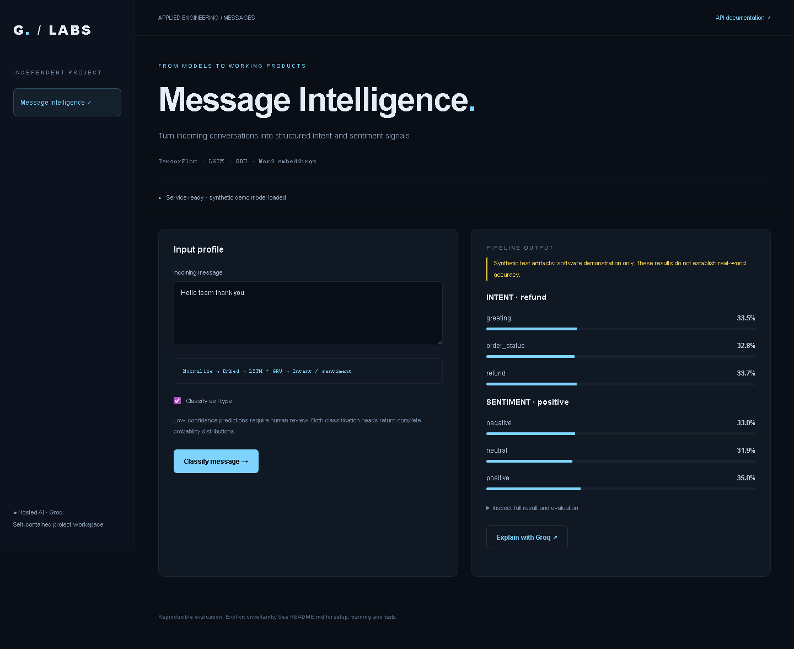
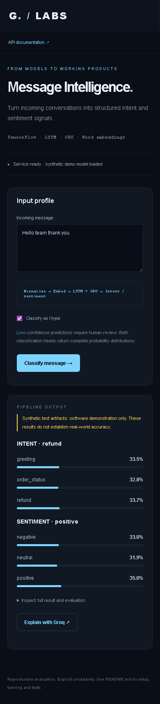

# Real-Time Message Classification System

[](https://github.com/morpheus-3/real-time-message-classification/actions/workflows/tests.yml)

## Screenshots



<details>
<summary>Mobile view</summary>



</details>


Independent runnable project in `real-time-message-classification`. Includes a browser UI, REST API, training command, artifact persistence and automated tests. Open the UI at **http://127.0.0.1:8014** and API docs at `/docs`.

## Install and start

Run from this folder (Python 3.10):

```powershell
py -3.10 -m venv .venv
.\.venv\Scripts\python -m pip install -r requirements.txt
$env:GROQ_API_KEY = '<your Groq API key>'
.\.venv\Scripts\python -m uvicorn projects.api:app --host 127.0.0.1 --port 8014
```

Groq is the only hosted AI provider. Optional explanations call its chat completions API, using `GROQ_MODEL` (default `llama-3.3-70b-versatile`). The requested Scikit-learn/TensorFlow/PyTorch models train and run locally; Groq cannot execute arbitrary custom model weights. Missing keys fail explicitly; no other provider is used. The explanation button sends the displayed model result to Groq, not the uploaded image. Set credentials in the server environment, never source code. The UI keeps inputs in page memory.

## Dataset and training


CSV: `text,intent,sentiment`. Supply 30+ complete messages, multiple intent/sentiment classes and 4+ examples per intent.

```powershell
.\.venv\Scripts\python -m projects.train path/to/messages.csv --epochs 20
```

Normalizes URLs, casing and whitespace; vocabulary is learned only from training messages. A shared embedding feeds LSTM and GRU branches with separate intent/sentiment heads. Reports held-out accuracy and macro-F1. Artifacts include the vocabulary and labels. `POST /messages/stream` returns a classification SSE event; `POST /messages/classify` returns JSON. Classification is request based, with a cached loaded model; restart the Python service after retraining.


## Test

```powershell
.\.venv\Scripts\python -m pytest tests -q
```

Tests train on deterministic synthetic fixtures, reload artifacts and exercise inference, validation and Groq request contracts. Synthetic metrics establish software execution only, not real predictive quality. Live Groq inference requires a valid key and quota and is not part of automated tests.

## Optional labeled demo data

```powershell
.\.venv\Scripts\python -m projects.fixtures projects/artifacts/fixtures
.\.venv\Scripts\python -m projects.train projects/artifacts/fixtures/messages.csv --epochs 2 --synthetic
```

Restart the service after training. Artifacts live in `projects/artifacts`, or `PROJECT_ARTIFACTS` if configured. Replace synthetic artifacts with models trained on appropriate real data before reporting quality. No real training dataset was supplied.
